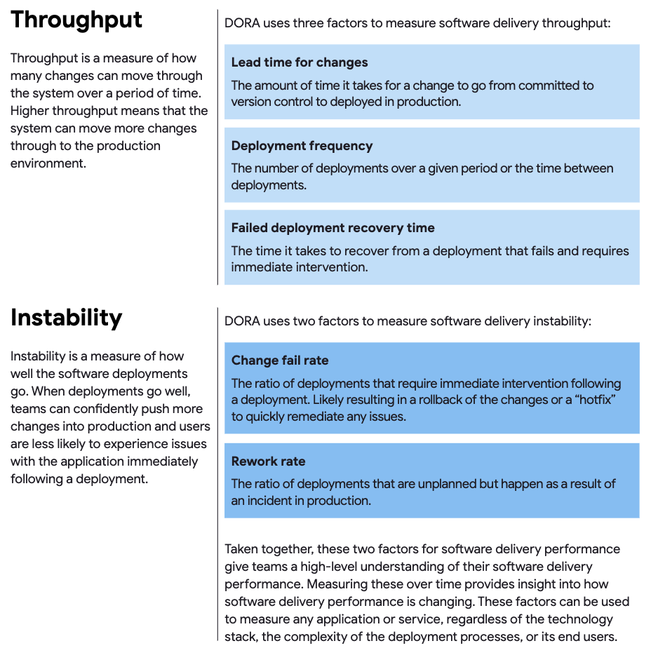

+++
title = "Métriques"
description = "Les métriques DORA : fréquence de déploiement, délai de livraison, taux d'échec des changements, temps de restauration, et les cinq métriques du rapport 2025."
weight = 10
+++

> [!ressource] Ressources
> - [Les DORA Metrics en 2024, c’est pas comme dans Accelerate en 2018](https://youtu.be/oKg470VioJ8)
> - [Les DORA Metrics, oui mais pour quoi faire ?](https://substack.jp-lambert.com/p/les-dora-metrics-oui-mais-pour-quoi?r=46wwe&triedRedirect=true)
> - [DORA's software delivery metrics](https://dora.dev/guides/dora-metrics-four-keys/)
> - [State of AI-assisted Software Development 2025 - DORA (PDF)](https://services.google.com/fh/files/misc/2025_state_of_ai_assisted_software_development.pdf)

## Deux questions simples

Les métriques DORA répondent à deux questions :

- **Débit** : *est-ce qu'on livre vite ?*
- **Stabilité** : *est-ce que ce qu'on livre fonctionne ?*

Chaque métrique éclaire l'une de ces deux questions. Les lire ensemble évite de tricher : déployer dix fois par jour n'a aucun intérêt si un déploiement sur deux casse la production.

## Les quatre métriques historiques

### Débit

#### Deployment Frequency
> *À quelle fréquence met-on en production ?*

Une fois par mois, une fois par semaine, plusieurs fois par jour. Déployer souvent oblige à livrer de **petits changements**, plus faciles à vérifier et à annuler.

#### Lead Time for Changes
> *Combien de temps entre le commit et la mise en production ?*

Une modification terminée qui attend trois semaines une fenêtre de mise en production est du stock : elle ne rapporte rien et vieillit. Un délai court signifie aussi un retour utilisateur rapide.

### Stabilité

#### Change Failure Rate
> *Quelle part des déploiements provoque un problème en production ?*

Un problème = il faut intervenir tout de suite : rollback, hotfix, correctif d'urgence.

#### Time to Restore
> *Quand ça casse, combien de temps pour revenir à la normale ?*

Les pannes arriveront toujours. La question n'est pas de ne jamais tomber, mais de **se relever vite**.

- en 2018 (*Mean Time To Restore*, MTTR), la mesure couvrait toute cause d'incident : bug, panne d'infrastructure…
- depuis 2023 (*Failed Deployment Recovery Time*, FDRT), elle ne compte que les incidents causés par un déploiement. Elle mesure donc la capacité de l'équipe à rattraper ses propres livraisons ratées.

### Le message clé

```
               Stabilité
                  ▲
   Lent mais sûr  │   Rapide ET sûr  ◄── les équipes "Elite"
                  │
   ───────────────┼───────────────► Débit
                  │
   Lent et fragile│   Rapide mais fragile
```

Intuitivement, on pense qu'aller plus vite rend plus fragile. Les données de DORA disent l'inverse : les meilleures équipes sont **à la fois** les plus rapides et les plus stables. Livrer petit et souvent réduit le risque de chaque livraison.

## Au-delà de la livraison : Reliability

Les quatre métriques mesurent l'efficacité du processus de livraison, pas la qualité du service rendu aux utilisateurs. DORA ajoute donc la **fiabilité** (*reliability*) : l'équipe fixe des objectifs de service (disponibilité, temps de réponse…) et vérifie qu'elle les tient.

Voir [Évolution 2018-2025]().

## Les métriques en 2025

Le rapport 2025 utilise cinq métriques, rangées en deux familles [^1] :

| Famille | Métrique | Ce qu'elle mesure |
| --- | --- | --- |
| **Débit** | Lead time for changes | Le temps entre le commit et la mise en production |
| | Deployment frequency | Le nombre de déploiements sur une période |
| | Failed deployment recovery time | Le temps pour se remettre d'un déploiement raté |
| **Instabilité** | Change fail rate | La part des déploiements qui demandent une intervention immédiate (rollback, hotfix) |
| | Rework rate | La part des déploiements non planifiés, faits à cause d'un incident en production |




Deux différences avec Accelerate :

- on parle d'**instabilité** et non plus de stabilité : plus le chiffre est haut, plus c'est mauvais ;
- le temps de restauration est rangé du côté du **débit** : se remettre vite d'un échec, c'est remettre le flux en marche. Une nouvelle métrique, le *rework rate*, compte le travail imprévu causé par les incidents.

> [!example] Exemple
> Sur 20 déploiements dans le mois :
> - 2 ont nécessité un rollback immédiat → *change fail rate* = 10 %
> - 4 n'étaient pas prévus et servaient à corriger un incident → *rework rate* = 20 %
>
> Le premier chiffre dit « combien de livraisons ratent », le second « combien d'énergie part à réparer au lieu de livrer ».

Ces métriques servent notamment à mesurer l'effet de l'IA sur la livraison : voir [IA et métriques DORA]().

[^1]: DORA, [State of AI-assisted Software Development 2025](https://services.google.com/fh/files/misc/2025_state_of_ai_assisted_software_development.pdf)
